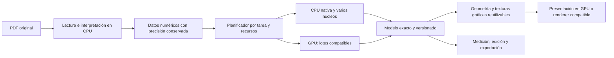

# Arquitectura para reconocimiento, capas y dibujo con precisión conservada

Investigación del 2 de noviembre de 2026. Este documento distingue el código
existente de las propuestas. No afirma que toda la arquitectura descrita esté
implementada. Complementa las [mediciones del filtro](aceleracion-hardware.md).

## Condición de aceptación

Optimizar significa hacer menos trabajo repetido, mover menos datos y ejecutar
tareas independientes simultáneamente. Se mantienen las funciones y la precisión
del resultado. La ruta actual sirve como referencia para cada cambio.

No se deben aumentar tolerancias, omitir utilidades difíciles, eliminar vértices,
reducir precisión del modelo ni desactivar funciones para ganar velocidad. La
selección, el imán, las medidas, los puntos de corte, las curvas, las conexiones,
los atributos y la exportación conservan sus reglas. Un resultado de fondo solo
puede publicarse si corresponde al estado vigente del documento y del modelo.

La imagen de pantalla es una representación del modelo: no debe convertirse en
la fuente de coordenadas del reconocimiento o de la exportación. Una caché puede
descartarse y reconstruirse; el modelo, el historial y los datos originales no.

## Qué significa aprovechar todo el hardware

La RAM almacena los datos con los que trabajan CPU y GPU; no ejecuta por sí sola
los algoritmos. Un consumo alto puede deberse a copias, imágenes grandes, cachés,
historial o datos legítimos del plano. La captura no demuestra por sí sola que la
RAM sea el cuello de botella. Hay que medir tiempo, memoria de los procesos,
copias, fallos de página y bloqueos de la interfaz.

La GPU tiene recursos adecuados para gráficos y lotes homogéneos; la CPU, para
parseo, dependencias y geometría con decisiones irregulares. La GPU integrada
normalmente comparte memoria del sistema: utilizarla no equivale a trasladar
datos a una reserva de VRAM independiente. La dedicada tampoco elimina la
necesidad de conservar datos de trabajo en CPU.

El objetivo es reducir el tiempo y la latencia de interacción aprovechando
recursos útiles. Mantener todos los motores al 100 % permanentemente puede
empeorar el resultado por competencia de memoria, transferencias y colas. Es una
decisión por tarea y tamaño de entrada, con límites globales de recursos.

La separación objetivo, que amplía los mecanismos existentes, es:

## Qué conceptos de motores gráficos ya existen en este programa

Revisión directa del código, no inferencias a partir de la captura:

| Concepto | Estado encontrado | Dónde |
| --- | --- | --- |
| Teselas y niveles de zoom | Implementados, con resolución según la vista | `ui/comun/teselas.py` |
| Priorizar lo visible y reutilizar otro nivel mientras llega una tesela | Implementado | `teselas_vista.py` |
| Procesos de rasterización independientes | Hasta tres, con heurística de CPU y RAM | `teselas_servidor.py` |
| Caché LRU de teselas | Límite nominal de 384 MiB; protege teselas solicitadas | `teselas_servidor.py` |
| Redibujar regiones y filtrar fuera de pantalla | Implementado para líneas y marcas | `capa_lineas.py`, `capa_marcas.py` |
| Agrupar muchas marcas en pocos objetos de escena | Implementado | `capa_marcas.py` |
| Reusar símbolos y fragmentos de imagen | Implementado | `capa_marcas_sellos.py`, `capa_marcas_vista.py` |
| Reusar cálculos cuando el modelo no cambió | Firma de contenido, memo e historial | `memo_modelo.py`, `ventana_dibujo.py` |
| Cálculos independientes de cruces y accesorios | Procesos separados según recursos | `calculo_fondo.py` |
| Cargar marcas en tandas para atender eventos | Implementado, presupuesto de 30 ms por tanda | `marcas_por_tandas.py` |
| Renderizado 3D en GPU, shaders e instancias | Implementado, con ruta alternativa si faltan capacidades | `visor3d.py`, `visor3d_instancias.py` |
| Cambiar visibilidad de utilidades sin reconstruir sus líneas | Máscara en la capa de líneas | `capa_lineas.py` |
| Filtro de recortes adaptable CPU/GPU | Primera etapa implementada y probada | `hoja/recorte_lotes.py`, `recorte_opencl.py` |

El lienzo 2D principal es un `QGraphicsView` con `QPainter`; en su constructor no
se instala un viewport OpenGL. La vista 3D sí usa `QOpenGLWidget`. Por tanto,
acelerar el filtro CUDA no convierte automáticamente todo el lienzo 2D en GPU.

El programa ya tiene parte importante de las técnicas de juegos y visores de
mapas. La oportunidad está en coordinar recursos, hacer más fina la invalidación
y eliminar transferencias y reconstrucciones que aún permanecen.

## Técnicas investigadas y aplicación concreta

### 1. Representación gráfica retenida y agrupación de dibujos

Conservar geometrías y símbolos ya preparados en buffers gráficos. Al mover la
cámara, actualizar la transformación; al ocultar una utilidad, cambiar su máscara;
al editar un tramo, actualizar su fragmento de buffer. Agrupar dibujos compatibles
sin alterar el orden de transparencias, trazos y rótulos.

Qt Quick usa precisamente agrupación de llamadas y retención de geometría en GPU.
Son conceptos aplicables a este proyecto; migrar a Qt Quick sería una modificación
de arquitectura, no activar una opción del `QGraphicsView` existente.
[Renderer de Qt Quick](https://doc.qt.io/qt-6/qtquick-visualcanvas-scenegraph-renderer.html).

Probar dos alternativas con las mismas escenas: mejorar el lienzo actual y un
prototipo gráfico retenido. Cambiar solo a `QOpenGLWidget` requiere atención:
Qt recomienda actualización completa para ese viewport, lo que puede perder
ventajas actuales del repintado parcial y desplazamiento. La decisión depende de
medir el cuadro completo. [QGraphicsView](https://doc.qt.io/qt-6/qgraphicsview.html).

El backend gráfico puede ser portable entre NVIDIA, AMD e Intel. Debe distinguirse
del backend de cómputo: CUDA, OpenCL y el renderizado de Qt cumplen funciones
distintas. [Scene graph de Qt](https://doc.qt.io/qt-6/qtquick-visualcanvas-scenegraph.html).

### 2. Datos compactos y buena localidad de memoria

Mantener tablas numéricas contiguas de coordenadas, índices y estilos, conservando
identificadores estables y precisión de las coordenadas. Es preferible compartir
una representación inmutable entre etapas a reconstruir diccionarios y objetos
geométricos completos en cada una.

Por ejemplo, 500 000 cajas de cuatro coordenadas `float64` ocupan 16 millones de
bytes de datos numéricos, aproximadamente 15,3 MiB, antes de índices y metadatos.
Esta cuenta ilustra un formato; no es una medición del ahorro total del programa.
El patrón de localidad de datos explica por qué el formato importa tanto como
la cantidad de núcleos. [Data Locality](https://gameprogrammingpatterns.com/data-locality.html).

Los datos autoritativos permanecen en la precisión actual. Una copia gráfica con
coordenadas locales puede usar otra representación únicamente si se comprueba su
error de pantalla y no se reutiliza para medir o exportar. El 3D ya resta un
origen local en `modelo3d.py` e `instancias3d.py`; conviene conservar esa separación.

### 3. Grafo de dependencias e invalidación selectiva

Actualmente la firma global del modelo evita mucho trabajo repetido, pero un
cambio del contenido invalida el memo general. El siguiente paso es identificar
qué resultados dependen de cada tramo, capa, región y regla.

Ejemplos: seleccionar una utilidad modifica su apariencia, no sus cruces;
cambiar un color invalida su presentación; mover un tramo invalida sus cruces,
accesorios y vecinos afectados; cambiar una normativa invalida los resultados
que la usan. Debe existir un registro completo de dependencias, incluidas las
que cruzan regiones. Un caché incompleto puede devolver resultados incorrectos.
Este es el patrón de marcar datos derivados como pendientes de recalcular.
[Dirty Flag](https://gameprogrammingpatterns.com/dirty-flag.html).

### 4. Búsqueda espacial conservadora seguida de cálculo exacto

Es la adaptación más directa de la detección de colisiones en juegos: primero
se reúnen candidatos mediante cajas o un índice espacial; después se aplica el
cálculo preciso. El filtro nunca puede excluir un candidato válido.

Aplicaciones: cruces, imán, selección, reconocimiento local y culling de pantalla.
La máscara vectorizada actual ya ayuda; con muchas utilidades y poco plano
visible conviene comparar una rejilla, BVH o R-tree con recorrer todas las cajas.
El tamaño desigual de los objetos y el coste de actualizar el índice influyen en
la elección. [NVIDIA: detección de colisiones y paralelismo](https://developer.nvidia.com/blog/thinking-parallel-part-i-collision-detection-gpu/).

Particionar el reconocimiento requiere conservar vecinos, márgenes y dependencias
de red. Cortar arbitrariamente en cuadrados puede perder una conexión o duplicar
un elemento en un borde. La recombinación debe verificarse contra la referencia.

### 5. Planificador global con prioridades y presupuestos

Actualmente varios subsistemas calculan por separado su concurrencia y memoria.
El límite de 70 % por proceso es un tope individual, no una reserva ni un límite
del conjunto. Las heurísticas de memoria por trabajador son aproximaciones.

Propuesta: un coordinador admite trabajos según memoria libre real, consumo
observado por tipo de tarea, CPU disponible y capacidad gráfica. Prioriza entrada
del usuario y dibujo visible, luego reconocimiento solicitado y por último
precarga. Con presión de memoria se suspende precarga o reduce concurrencia;
se conserva la misma tarea y precisión.

Hay trabajo de rasterización en varios procesos, cálculo de plano en otros y
reconocimiento en un trabajador. Abrir más procesos no garantiza acelerar:
cada uno puede mantener sus propios documentos, listas de dibujo y cachés.
PyMuPDF recomienda procesos separados para paralelizar sus operaciones; no
compartir el mismo documento entre hilos.
[PyMuPDF](https://pymupdf.readthedocs.io/en/latest/recipes-multiprocessing.html).

### 6. Menos copias entre procesos y memoria gestionada en conjunto

Los fondos grandes pasan por archivos RGB temporales y luego por copias hacia
`QImage`/`QPixmap`. Las teselas vuelven como bytes a través de `Pipe`. Existe una
oportunidad para un conjunto acotado de buffers compartidos con propietario,
generación y confirmación de consumo. Esto evita serializar algunas cargas
numéricas, pero no garantiza cero copias hasta la GPU.

Python ofrece memoria compartida para arrays entre procesos. Requiere limpiar
recursos y evitar reutilizar un buffer mientras otro consumidor lo lee.
No se comparten directamente los documentos MuPDF.
[SharedMemory](https://docs.python.org/3/library/multiprocessing.shared_memory.html).

Un fondo de 100 millones de píxeles representa unos 300 MB en RGB, 400 MB en
RGBA o 100 MB en gris. Son formatos posibles, no tres copias necesariamente
simultáneas. Los picos deben medirse. Las cachés de teselas, sellos, capas de
pintado e historial necesitan un presupuesto conjunto y métricas de uso real.

### 7. Presupuesto de interfaz, colas acotadas y versiones

Hay tandas y lectura de resultados con presupuestos de hasta 30 ms. Un objetivo
de 60 cuadros por segundo deja unos 16,7 ms para todo el cuadro. Conviene medir
latencia de eventos y repartir preparaciones en intervalos menores, sin eliminar
trabajo. Un presupuesto demasiado pequeño también puede aumentar el tiempo total.
[Consideraciones temporales de Qt](https://doc.qt.io/qt-6/qtquick-performance.html).

Una petición de zoom o capas debe llevar una versión. Se pueden reemplazar
peticiones de presentación obsoletas, pero no perder cambios del modelo ni su
historial. La cola de presentación conserva la petición vigente y sus dependencias;
al recibir un resultado antiguo se descarta o guarda solo en un caché identificado.

Los widgets se actualizan en el hilo de interfaz. Preparar imágenes fuera de él
es posible con propiedad y sincronización adecuadas; dos hilos no deben pintar
simultáneamente sobre el mismo dispositivo.
[Hilos y pintado en Qt](https://doc.qt.io/qt-6/threads-modules.html).

## Precaución específica al activar y quitar capas PDF

Las capas de utilidades dibujadas por la aplicación ya pueden filtrarse con una
máscara. Las capas nativas del PDF son diferentes: `_render()` modifica su
visibilidad y genera de nuevo el fondo; el trabajador invalida listas de dibujo
cuando cambia su firma. Volver a teselas ya calculadas puede evitar parte del coste.

Mejorar este flujo significa reutilizar por estado y región y priorizar lo visible.
Separar cada OCG en una textura independiente exige demostrar que reproduce
recortes, orden de dibujo, grupos y transparencias del documento. La composición
independiente por capa no debe darse por equivalente automáticamente.

## Compatibilidad incorporada en esta revisión

Se eliminó `requirements-cuda.txt`. La GPU es opcional y solo a petición
(`PDFCAD_ACELERACION`): PyOpenCL y CuPy se instalan aparte y no van en `requirements.txt`.
OpenCL amplía fabricantes; el controlador y las capacidades concretas determinan
si una GPU puede utilizarse. El filtro actual exige doble precisión. No se baja a
precisión simple para hacer pasar un dispositivo incompatible.

Se ejecutó el filtro OpenCL en la AMD integrada y en la RTX 3050 de este equipo.
Los resultados coincidieron con CPU. El selector compara rutas y elige una;
no divide actualmente un lote entre varias GPU. No se verificó físicamente Intel.
[PyOpenCL](https://documen.tician.de/pyopencl/), [OpenCL de Khronos](https://www.khronos.org/opencl/).

## Orden propuesto y prueba de aceptación

1. Registrar tiempos y memoria por etapa, copias y latencia de interfaz en escenas
   representativas. Separar arranque, caché fría y caliente. El filtro ya cuenta
   con diagnóstico; el resto necesita trazas de extremo a extremo.
2. Coordinar presupuestos globales y precarga. Reutilizar versiones y datos sin
   cambiar los algoritmos geométricos. Medir abrir/cerrar repetidamente para
   detectar crecimiento de memoria.
3. Hacer selectiva la invalidación y comparar índices espaciales. Verificar casos
   de borde, redes conectadas entre regiones y cambios de normativa.
4. Llevar los cálculos exactos dominantes a operaciones nativas o por lotes con
   precisión equivalente. Elegir CPU/GPU por medición, no por una marca fija.
5. Evaluar el renderizado 2D retenido con las mismas funciones de interacción y
   calidad. Mantener el renderer anterior hasta demostrar compatibilidad.

La evaluación debe incluir geometría y topología, atributos por utilidad,
selección e imán, capas con opacidad y transparencia, zoom y pan, varios monitores,
deshacer/rehacer, guardar/reabrir, exportación y cancelación durante cambios.
Los tiempos se comparan con varias repeticiones y percentiles, además del pico
de memoria del conjunto de procesos. Un porcentaje alto de uso de GPU no es una
prueba de mejora ni de exactitud.
